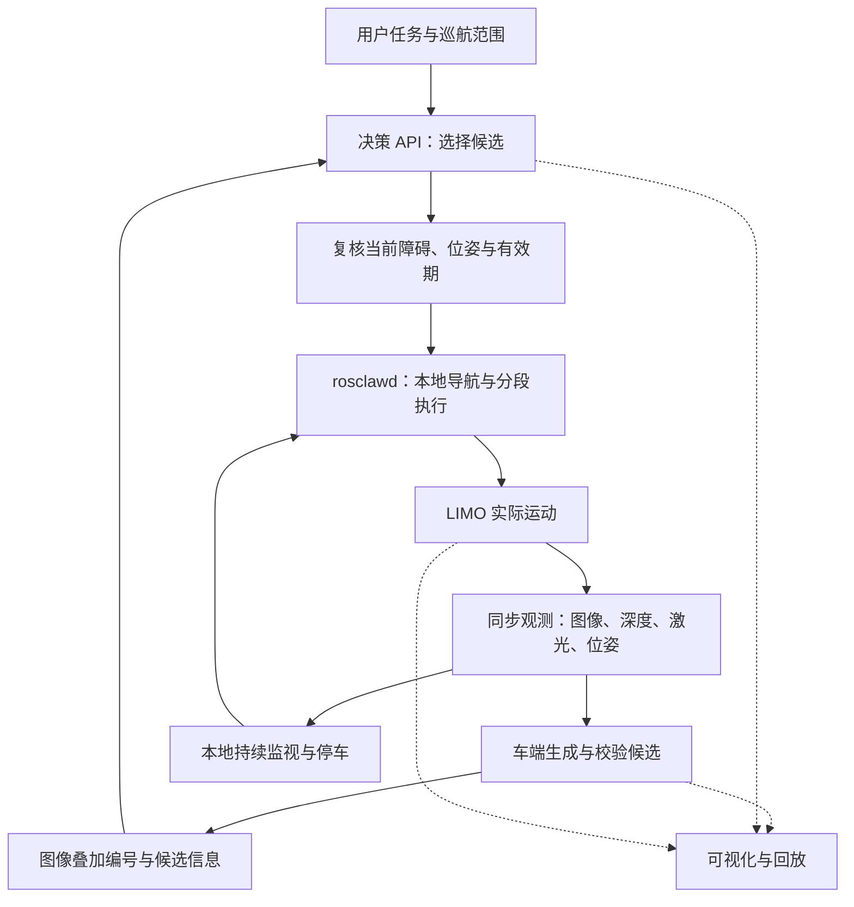

MO：车端根据传感器生成几条可执行路线，画到相机图像上；决策模型选择其中一条，小车执行一小段，再观察、再选择。**

这与你提出的“在图像上选择直行、左转一点、右转一点，或者不同线速度、角速度”很接近，而且能够把模型的作用清楚地展示出来。

我建议第一版采用：

> **RGB 图像理解场景 + 激光／深度检查可通行性 + 决策 API 选择候选动作 + 车端闭环执行 + 同步展示选择与实际轨迹。**

下面是结合你的仓库、OpenAI 当前接口，以及相关导航研究整理出的方案。仓库审查基于公开 `main` 分支的 `0c7cf9a`；你车上实际安装的版本、传感器在线状态和底盘模式，还需要由车上的 Codex 核对。

## 一、你说的决策 API，确实很适合做这个实验

我专门核对了 OpenAI 当前官方文档。**Decisions API 支持输入图像、文本和 JSON，并从提供的候选项中进行选择，返回选中项及各选项概率。** 截至本次查询，官方文档列出的支持模型为 `gpt-6-luna`，入口是 `POST /v1/decisions`。[OpenAI API](https://developers.openai.com/api/docs/guides/decisions?utm_source=chatgpt.com)

它的接口形式与你的需求相当契合：

| 接口能力 | 在 LIMO 上可以怎样用 |
|---|---|
| `choice`：从候选项中选择 | 从“左侧绕行、直行、右侧绕行、等待”等候选中选一个 |
| `predicate`：判断一个条件 | 判断画面中是否出现目标门口、是否需要重新观察 |
| `score`：按分级标准评分 | 对路线与任务要求的符合程度作辅助评估 |

这些是接口能力；具体如何组织机器人动作，是我们需要设计的应用层。官方 API 参考也明确给出了图像输入和候选选项的数据结构。[OpenAI API Reference](https://developers.openai.com/api/reference/resources/decisions/methods/create?utm_source=chatgpt.com)

**最有展示价值的是：可以把每个候选动作的返回概率，直接画在对应路线旁边。**

不过，界面上应该称它为“模型选择概率”或“模型偏好”，不能称为“安全概率”。“模型更倾向于选右侧”与“右侧一定不会碰撞”是两回事。

如果你手里的“决策模型 API”实际指普通多模态推理接口，也能沿用同一套方案，只需用受约束的结构化输出返回候选 ID。实际端点和模型支持情况，应先在车上用一张静态图片确认。

## 二、你的 LIMO MCP 已经有什么，还缺什么？

我看了源码。这个项目已经具备可复用的机器人接口基础，但需要补上视觉决策与执行之间的闭环。

### 已有基础

| 能力 | 仓库当前情况 | 对这次工作的帮助 |
|---|---|---|
| ROS 导航 | ROS 1，已有 AMCL、`move_base`、`GlobalPlanner`、`TrajectoryPlannerROS` 相关接口 | 可以先沿用现有导航栈 |
| 激光、里程计、状态 | 声明了 `/scan`、`/odom`、`/limo_status` 等观测 | 可用于几何检查、运动反馈 |
| RGB-D 相机 | 有彩色、深度、点云、相机标定信息的观测契约 | 具备做视觉与几何融合的接口基础 |
| 相机截图 | `limo_capture_camera_frame` 实际支持彩色和红外单帧 | 可以给视觉模型提供画面 |
| 导航请求 | 通过 `rosclawd` 提交单个地图坐标目标 | 可用于第一阶段的子目标选择实验 |
| 结果核验 | 有动作状态、执行回执和位移证据 | 能核对“模型发出选择后，车到底动没动” |

依据是仓库的 [观测契约](https://github.com/ros-claw/limo-ros-mcp/blob/0c7cf9a92510dc8867faf404a946d8131ba956ff/src/limo_ros_mcp/contract.py)、[MCP 实现](https://github.com/ros-claw/limo-ros-mcp/blob/0c7cf9a92510dc8867faf404a946d8131ba956ff/src/limo_ros_mcp/server.py) 和 [导航动作定义](https://github.com/ros-claw/limo-ros-mcp/blob/0c7cf9a92510dc8867faf404a946d8131ba956ff/src/limo_ros_mcp/action_specs/navigation.py)。

### 有三个特别影响方案的缺口

**第一，当前接口接收的是目标点，不是完整路径。**

现有 `limo_request_navigation` 主要接收 `(x, y, yaw)`。

假设我们画出左绕、右绕两条路线，模型选了右绕，但程序最后只把两条路线共同的终点发给 `move_base`，那么底层仍然可能从左侧过去。

因此要区分：

- **模型选择子目标**：模型决定下一步去哪个位置，ROS 决定怎样抵达。
- **模型选择路径**：模型选中的路线或通行走廊，会对执行产生实际约束。

前一种可以较快利用现有接口完成；后一种需要新增路径／走廊执行能力。这个区别应当直接体现在界面和实验结论里。[源码依据](https://github.com/ros-claw/limo-ros-mcp/blob/0c7cf9a92510dc8867faf404a946d8131ba956ff/src/limo_ros_mcp/action_specs/navigation.py)。

**第二，现有观测摘要还不足以生成导航画面。**

当前地图和 costmap 主要返回统计摘要；相机截图工具也没有直接返回可用于几何计算的深度帧。需要新增一个有界的场景快照模块，在车端处理深度、激光、地图和位姿，再输出候选与叠加图。[源码依据](https://github.com/ros-claw/limo-ros-mcp/blob/0c7cf9a92510dc8867faf404a946d8131ba956ff/src/limo_ros_mcp/server.py)。

另外，README 中常用的 `core` 配置不含相机截图工具。后续视觉实验要明确使用包含相机能力的工具配置。[工具配置](https://github.com/ros-claw/limo-ros-mcp/blob/0c7cf9a92510dc8867faf404a946d8131ba956ff/src/limo_ros_mcp/profiles.py)。

**第三，连续巡航需要一个新的任务执行入口。**

当前 REAL 导航采用单次目标确认。要实现“出去转一圈”，需要正式增加一个有区域、时长、速度和停止条件的巡航任务，由 daemon 在任务范围内运行分段决策。

这属于需要开发的能力。现有 `MotionWatchdog` 主要检测“下达运动指令后是否出现里程计响应”，也不能直接当作全过程避障和云端失联停车机制。[导航接口](https://github.com/ros-claw/limo-ros-mcp/blob/0c7cf9a92510dc8867faf404a946d8131ba956ff/src/limo_ros_mcp/server.py)、[导航 worker](https://github.com/ros-claw/limo-ros-mcp/blob/0c7cf9a92510dc8867faf404a946d8131ba956ff/worker/limo_navigation_worker.py)。

## 三、你提到的 DWA、VFH、图像选动作，应该怎样取舍？

### 1. DWA：适合把“速度选择”变成“轨迹选择”

可以把它理解为：

> 尝试若干组前进速度和转弯速度，预测小车接下来会走出的曲线，再比较这些曲线。

对于差速底盘，一组短时动作可以写成：

\[
a_i=(v_i,\omega_i,T_i)
\]

分别表示线速度、角速度和执行时长。它可以对应“慢速小幅左转”“慢速直行”“慢速小幅右转”等动作。

**DWA 本身并不要求必须用激光。** ROS 的实现使用代价地图和机器人状态；障碍地图也可以由深度相机产生的点云构建。Nav2 的障碍层明确支持 `LaserScan` 与 `PointCloud2`。[GitHub](https://github.com/ros-planning/navigation/blob/noetic-devel/dwa_local_planner/src/dwa_planner_ros.cpp?utm_source=chatgpt.com)

对你的项目，可以借鉴它的**采样、预测、检查候选轨迹**的思想，再让模型根据图像和任务挑选候选。

首版没有必要为了这个展示，先替换掉现有 `TrajectoryPlannerROS`。

### 2. VFH：适合展示“哪些方向有开口”

VFH 类方法更像是在车周围画一圈扇区：

- 哪些方向障碍密集；
- 哪些方向有空隙；
- 哪些空隙足够宽。

它特别适合做你说的“可通行区域选择”。

但**一个方向眼前有空隙，不代表后面通向目标，也不代表车能按当前姿态转进去**。VFH 后续版本专门增加了车体宽度、转弯约束和前瞻验证，正是为了解决这些问题。[cs.cmu.edu](https://www.cs.cmu.edu/~iwan/papers/vfhstar.pdf?utm_source=chatgpt.com)

所以我建议：

> 可以把扇区图作为辅助可视化；真正交给模型执行的选项，应当对应经过运动学与车体碰撞检查的动作或路线。

### 3. 直接让模型输出线速度、角速度：适合做对照实验

例如模型直接回答：

```text
线速度 0.12 m/s
角速度 -0.20 rad/s
```

这当然可以研究，但会把几个难题混在一起：距离估计、车体尺寸、速度尺度、网络延迟，以及如何从上一条指令平滑切换到下一条。

**更适合首版的做法，是车端先生成这些速度组合对应的轨迹，模型选择其中一个。**

这样模型仍然在决定行动，只是动作具有清晰、可检查的物理含义。

还有一个很容易忽略的问题：

> **不要把“左绕”和“右绕”的概率加权平均成速度。**

两侧都能绕过箱子时，左右转向的平均值可能恰好是直行，指向箱子。也不宜分别独立询问“选多大线速度”和“选多大角速度”，再随意组合。应当选择一个已经联合验证过的动作。

### 我的取舍建议

| 方案 | 适合程度 | 用途 |
|---|---:|---|
| 模型看图，选择下一子目标 | 高 | 最快利用现有 MCP 验证模型作用 |
| **模型选择几何验证后的短轨迹／通行走廊** | **最高** | 最适合你要的决策展示 |
| 模型选择 VFH 可行方向，再生成轨迹 | 高 | 适合做方向选择与扇区展示 |
| 模型直接输出任意 `v、ω` | 较低 | 后续作为实验对照 |
| 纯单目、完全由云模型承担避障 | 首版不推荐 | 需要额外解决尺度、盲区、延迟与执行可靠性 |

## 四、已经有很贴近的研究，可以直接借鉴思路

这次最有参考价值的，是下面几个项目。

### VLMnav：与你设想的界面最接近

[VLMnav](https://jirl-upenn.github.io/VLMnav/) 的流程就是：

1. 用深度和位姿估计可走区域；
2. 提出候选动作；
3. 把候选投影成第一视角图像上的编号箭头；
4. 让视觉模型选择动作。

它有[官方代码](https://github.com/Jirl-upenn/VLMnav)，可以重点参考候选生成、动作与编号映射、相机投影和选中高亮。[jirl-upenn.github.io](https://jirl-upenn.github.io/VLMnav/?utm_source=chatgpt.com)

但实机移植时要非常清醒：论文主要在仿真中评测，作者明确承认可走判断没有完整考虑机器人尺寸和形状，实验还依赖模拟器允许沿障碍“滑动”的设置。因此适合借鉴接口和表达方式，不能直接把其避障逻辑搬上 LIMO。[arxiv.org](https://arxiv.org/html/2411.05755v1?utm_source=chatgpt.com)

### CoNVOI：更接近真实小车的执行结构

[CoNVOI 论文](https://arxiv.org/html/2403.15637v1) 使用图像与激光占据图，在可通行位置标注编号，让视觉模型选出参考路线，再交给本地运动规划器跟踪。论文在 Turtlebot 2 和 Spot 上做了实机实验。[arxiv.org](https://arxiv.org/html/2403.15637v1?utm_source=chatgpt.com)

它对你的启发尤其直接：

> 模型决定符合场景和任务的行驶方式，本地规划控制器持续处理运动与障碍。

论文也专门讨论了云端响应延迟，通过有条件的路径延长和重查询减少等待。不过这些策略仍受网络和动态环境影响，不能把论文中的旧模型延迟直接套到今天的 Decisions API。[arxiv.org](https://arxiv.org/html/2403.15637v1?utm_source=chatgpt.com)

### PIVOT：解释了为什么“画出选项”值得尝试

[PIVOT](https://pivot-prompt.github.io/) 把动作候选画在图像上，让视觉模型选择，再迭代细化候选。它提供了真实机器人导航等实验，也明确注明演示视频剪掉了模型推理等待时间。[pivot-prompt.github.io](https://pivot-prompt.github.io/?utm_source=chatgpt.com)

因此，你的演示最好同时保留真实耗时记录。画面可以剪辑，但不要让观众误以为云模型一直在毫秒级控制小车。

此外，[ViPlanner 的 ROS 实现](https://github.com/leggedrobotics/viplanner/blob/main/ros/README.md) 有现成的“路径投影到 RGB／深度视频”的模块分工，值得借鉴可视化结构；它针对的机器人和相机与 LIMO 不同，官方也要求显著更换平台时重新训练，所以首版不必引入其完整学习式规划器。[GitHub](https://github.com/leggedrobotics/viplanner/blob/main/ros/README.md?utm_source=chatgpt.com)

## 五、我建议的完整结构

下面是目标架构示意，其中候选生成、决策适配与连续巡航执行，是需要新增的部分。



### 1. 先在真实空间生成候选，再投影到图片

这一步决定系统是否扎实。

建议顺序是：

**深度／激光形成局部障碍表示 → 根据底盘生成候选 → 检查车体经过的范围 → 把合格候选投影到 RGB 图像。**

每个候选至少保留：

| 信息 | 作用 |
|---|---|
| 候选 ID | 让模型选择，执行侧查表 |
| 所属快照与候选集版本 | 防止新旧画面混用 |
| 实际坐标中的路径或子目标 | 把图像选项对应到物理空间 |
| 速度配置、运动模式 | 确保底盘能够执行 |
| 路径净空、长度、终点 | 给执行检查和界面使用 |
| 有效期与停止条件 | 约束陈旧决策和异常情况 |

这里检查的应该是**整个车体扫过的区域**，包含转弯时的边角；仅检查中心线或终点不够。

建议向模型展示**至多 5～9 个彼此容易区分的候选**，并保留等待、停止或重新观察的选项。没有足够候选时就减少数量，不必凑满。

### 2. 候选必须适配 LIMO 当前运动模式

如果实际使用差速模式，可以考虑：

- 直行；
- 小幅左弯、较大左弯；
- 小幅右弯、较大右弯；
- 在周围空间允许时，原地转向观察。

如果使用阿克曼模式，就必须按照转弯半径生成曲线，不能给它原地旋转动作。LIMO 官方手册明确区分了这两类运动能力。[github.com](https://github.com/agilexrobotics/limo-doc/blob/master/Limo%20user%20manual\(EN\).md?utm_source=chatgpt.com)

**第一版我倾向差速模式**，因为房间和走廊中的转向、重新观察、掉头更容易实现。最终仍要以你这台车的机械设置和驱动反馈为准。

### 3. 模型每次需要看到什么？

不需要把全部 ROS 数据塞进上下文。建议每轮发送：

- 当前任务，例如“离开房间，沿走廊巡视后返回”；
- 当前任务阶段，例如“正在寻找房间出口”；
- 原始 RGB 图或候选叠加图；
- 少量候选的物理信息；
- 必要的历史，例如已经经过哪个门口、刚才哪条路线被阻挡。

这段历史由程序显式维护。模型才能区别“这条路还没去过”和“刚刚已经在那里转了一圈”。

**几何模块回答哪里能走；模型结合任务、视觉语义和历史回答这次该走哪里。**

### 4. 首轮采用“停稳—选择—走短段”的闭环

我建议第一轮按这个节奏做：

1. 小车停稳，获取时间对应的图像、位姿和障碍信息。
2. 生成候选，冻结这一轮的编号。
3. 调用决策 API。
4. 收到结果后，用最新传感器重新检查被选候选。
5. 执行一个短段。
6. 根据实际运动结果进入下一轮。

这样已经可以完整证明模型影响了行动，也便于定位问题。

后续再优化为边走边决策：本地控制器持续运行，云端在子目标即将完成、岔路出现、候选失效或任务变化时更新选择。

车端控制可以先以约 **20 Hz** 作为调参目标；云端频率由实际请求耗时决定。请求耗时要测完整结果返回的 P50、P95，而不只看首个响应字符。

### 5. 每个选择都要绑定当时的场景

例如，上一帧的 `R3` 是右绕路线，下一帧重新编号后的 `R3` 可能已经变成直行。

执行端应当检查：

- 返回结果属于哪一轮请求；
- ID 是否属于那一轮候选；
- 请求是否过期或已被更新；
- 小车现在的位置和速度是否还能接入这条路线；
- 新出现的障碍是否使它失效。

移动中的候选应保存在实际坐标系中，并用当前位姿重新检查。**旧图片上的像素曲线，不能直接贴到新图片上继续执行。**

### 6. 本地停车与云模型选择分开运行

假设车速是 `0.15 m/s`，云端一次响应耗时两秒，这期间就可能移动 `30 cm`。这只是算例，却足以说明为什么近场停车必须依靠车端。

本地需要持续检查障碍、传感器是否更新、动作是否过期，以及执行进度。所有速度来源最终经过统一出口，避免导航、人工控制和另一个程序同时向底盘发命令。

Nav2 的 Collision Monitor 就体现了这类分工：它直接使用传感器增加一层碰撞监视，并放在速度处理链末端。你的当前系统是 ROS 1，可以借鉴其结构原则，不能直接当作已经装好了 ROS 2 的组件。[Nav2 Docs](https://docs.nav2.org/rolling/configuration_and_development/configuration_guide/core_servers/collision_monitor/configuring_collision_monitor_node/?utm_source=chatgpt.com)

## 六、怎样可视化，才能让人一眼看懂模型在做什么？

我建议做一个 **16:9 的决策驾驶界面**。最重要的是下面三块。

### 左侧大画面：小车实际看到的场景

占主要面积，展示：

- 当前 RGB 画面；
- 几何检查得到的可通行区域；
- 清楚的候选编号和轨迹；
- 模型最终选中的路线；
- 该选择对应的快照时间。

颜色可以这样约定：

| 内容 | 建议表达 |
|---|---|
| 可通行区域 | 低透明度蓝色 |
| 可选择路线 | 白色或浅蓝细线，带编号 |
| 模型选中路线 | 明亮绿色粗线 |
| 新障碍导致失效的路线 | 红色，并显示失效原因 |
| 未知区域 | 灰色，不标成可通行 |

**候选图必须由真实几何投影生成。** 相机内参、相机与底盘的外参、深度注册、时间同步，以及图像缩放后的内参，都要匹配。否则画面会很好看，但箭头并不对应车真正要去的位置。

### 右上：俯视地图与真实轨迹

同时显示：

- 小车当前位置和车体轮廓；
- 房间、走廊、障碍；
- 模型选择的子目标或参考路线；
- 当前本地规划路线；
- 已经实际走过的轨迹；
- 起点、已访问位置、允许活动范围。

这里尤其建议区分三条线：

> **模型想走的路线、控制器当前规划的路线、车实际走过的路线。**

它们之间的差异，能直接揭示模型选择是否落到了执行上。

### 右下：候选概率与执行状态

例如下面这个表，**数字只是界面示意，不是实测结果**：

| 候选 | 模型选择概率 | 当前执行状态 |
|---|---:|---|
| 左侧慢速绕行 | 18% | 可用 |
| 右侧慢速绕行 | 73% | 已选中 |
| 等待 | 9% | 可用 |

几何检查淘汰的路线可以显示在另一栏，注明“车体空间不足”等原因。它们没有送入模型时，不要给它们编造一个模型概率。

再展示几个简洁状态：

- 本轮模型耗时；
- 当前目标；
- 实际线速度、角速度；
- 本地保护是否介入；
- 等待模型、正在执行、重新观察、已返回等任务状态。

### 关于“为什么选择这条路”

这里要注意接口能力：Decisions 的主要输出是类型化决策，并不自动提供一段自然语言解释。官方文档把自定义对象或文字说明的生成，放在 Responses／Structured Outputs 这一类能力中。[developers.openai.com](https://developers.openai.com/api/docs/guides/decisions.md?utm_source=chatgpt.com)

第一版可以先展示可验证的依据，例如：

> 当前任务：从右侧经过桌子。<br>
> 候选 R2：右侧通道，几何检查通过。<br>
> 模型选择：R2。<br>
> 执行结果：已进入右侧通道。

如果后续另外生成一句说明，应标明它是根据本轮记录生成的展示说明。**模型效果最有力的证据，是选择与实际行动对应，而不只是解释说得流畅。**

### 工具选择

工程调试先用现有 **RViz**，它已有相机、路径、点云和 Marker 等显示能力；候选叠图由程序直接生成，再提供给模型与界面共用。[GitHub](https://github.com/ros-visualization/rviz/blob/noetic-devel/plugin_description.xml?utm_source=chatgpt.com)

等闭环成立后，再做轻量网页展示上述布局。这样不用一开始同时维护 RViz、Foxglove、Rerun 三套可视化系统。

## 七、怎样完成“去走廊转一圈”？

这句话需要变成一个可判断是否完成的任务。

我建议第一版定义为：

> **从起点出发 → 离开房间 → 沿允许的走廊巡视到指定检查点或距离 → 在合适位置掉头 → 返回起点并停车。**

如果走廊本身有环路，后续再做真正的环形绕行。

### 首版建议使用当前场地的二维地图

模型可以根据画面选择门口、绕行方向和下一子目标；地图与定位用于约束活动范围和组织返航。

需要记录：

- `home`：起点；
- `door`：房间出口或其区域；
- 允许巡视的走廊；
- 禁止进入的区域；
- 已走过的路线；
- 返回条件。

仅靠“眼前没有障碍就继续往前”，可以实现局部游走，却不能据此承诺会回到起点或不会反复走同一段。

楼梯口等位置，首轮应直接排除在允许范围之外。普通二维激光的无遮挡方向，不能证明前方地面连续。

### 连续巡航的接口建议

可以正式新增一个任务，例如：

**拟新增：`limo.visual_patrol`**

它绑定具体的任务范围，包括地图与策略版本、允许区域、任务结束条件、最大时长／行程、速度上限和中止条件。daemon 在这个范围内运行观察、决策和分段导航。

这是新增的任务合同与执行器。初始 readiness 也不能覆盖整个巡航过程，每个分段仍要更新观测并验证。

你的仓库已经要求动作经过 ROSClaw 执行边界，因此这部分应接在现有 daemon 内。[仓库工程规则](https://github.com/ros-claw/limo-ros-mcp/blob/0c7cf9a92510dc8867faf404a946d8131ba956ff/AGENTS.md)。

## 八、怎样证明决策模型确实有帮助？

**只让小车在空走廊绕过一个箱子，未必能体现模型优势。** 传统局部导航本来就擅长这种任务，可能还会更快、更稳定。

最值得做的是：**多个方向在几何上都能走，但任务含义要求不同选择。**

### 我建议先做这四类实验

| 实验 | 任务示例 | 主要检验什么 |
|---|---|---|
| 同场景，不同指令 | “从椅子左边过去”／“从椅子右边过去” | 模型能否依据语言改变实际路线 |
| 视觉目标选择 | “去蓝色门牌旁边的入口” | 模型能否把视觉语义对应到导航目标 |
| 巡视与返回 | “出门巡视，不进入其他房间，然后回来” | 任务阶段、历史与返航是否有效 |
| 路线变化 | 原可行通道被箱子挡住，另一侧仍可通行 | 是否重新观察、改变选择并执行 |

有人突然横穿时，小车及时停车很重要，但这主要用于验证本地保护反应。若要证明模型理解“等人先过”，就要单独记录模型何时选择等待，不能把所有停车都算作模型功劳。

### 保持候选与执行器相同，只替换选择方式

建议比较：

1. **几何基线**：从相同候选中，按距离、净空、转向代价选择。
2. **图像模型方案**：给模型原图和候选文字说明。
3. **候选叠图方案**：给模型相同信息，再加入图像上的路线与编号。

这样可以分别观察：模型是否有帮助，以及把候选画出来是否有帮助。

还建议加两个很便宜、但有说服力的检查：

- **同一张图改变任务要求**：选择应当合理改变。
- **同一物理路线随机换编号**：选择应仍对应正确路线，而不是总偏爱某个编号。

### 至少记录这些指标

- 任务完成率、错进区域次数；
- 人工接管次数、本地保护介入次数；
- 路程、总耗时、等待模型的时间；
- 请求耗时 P50／P95、每个任务调用量；
- 模型选择被拒绝的次数及原因；
- 选中子目标是否抵达，或选中路径是否得到执行；
- 实际运动证据。

对你的仓库，最后一项尤其重要：**短距离目标如果已经落在导航容差内，系统可能马上报告到达。** 分段距离要与当前目标容差配套，验收要看真实位移和停车状态。[执行核验实现](https://github.com/ros-claw/limo-ros-mcp/blob/0c7cf9a92510dc8867faf404a946d8131ba956ff/worker/limo_navigation_worker.py)。

## 九、具体推进顺序

我建议按下面五步完成，尽早拿到第一段真实闭环视频。

| 阶段 | 做什么 | 完成标志 |
|---|---|---|
| **1. 核对真机基础** | 检查版本、运动模式、相机／深度／激光／TF、地图、导航参数、现有执行器 | 有一份实际在线能力清单，明确缺项 |
| **2. 小车静止，验证视觉选择** | 生成真实几何候选、投影叠图、调用决策 API、显示概率 | 同一画面改任务，选项能合理改变；编号与物理路线对应正确 |
| **3. 单段监督实验** | 利用现有导航接口选择不同子目标，按现有确认流程执行 | 选中目标、实际位移、执行回执一一对应 |
| **4. 有界自主巡航** | 新增巡航任务与 daemon 执行器，持续复核、停止、返航 | 能在限定房间／走廊完成一个完整任务 |
| **5. 路径选择展示与对照** | 根据需要加入路径／走廊执行约束，完成同步界面和重复实验 | 能说明模型改变了哪些选择、实际执行怎样、相比基线有何差异 |

车上的 Codex 可以负责开发、部署和分析这些模块。运行时建议由一个专门的巡航程序调用决策 API，再通过 daemon 执行；不必让 Codex 的交互会话承担每一轮高频运动调度。

**我最希望第一轮做出来的演示，是同一处障碍摆放，先说“从左边过去”，再说“从右边过去”。屏幕上同时出现真实候选、API 返回概率和小车实际轨迹，两次路线明确不同。** 这个实验规模小，却能够把“看懂指令、理解场景、选择行动、真实执行”完整串起来。

随后再把它扩展为“离开房间、巡视走廊、遇阻换路、返回起点”。这样最终呈现出来的决策能力，每一层都有实际运行证据支撑。
